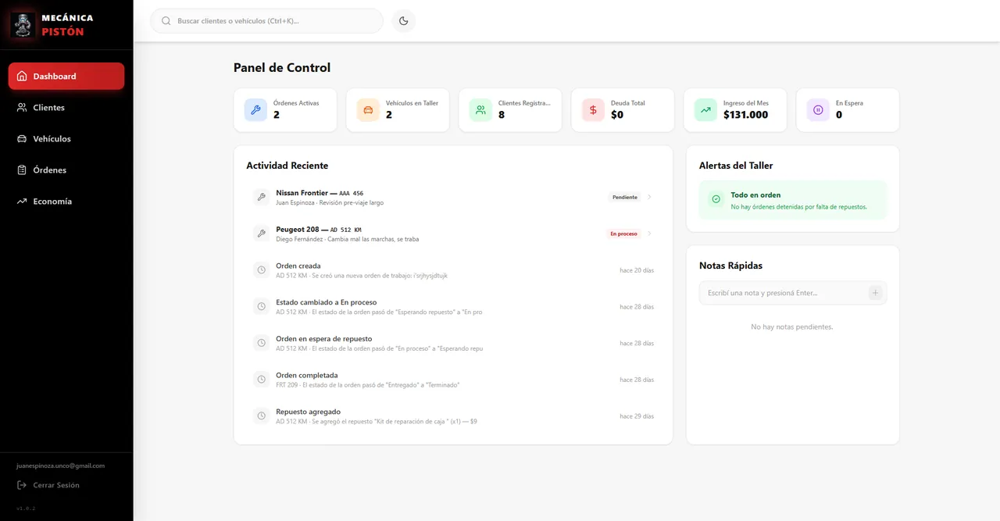
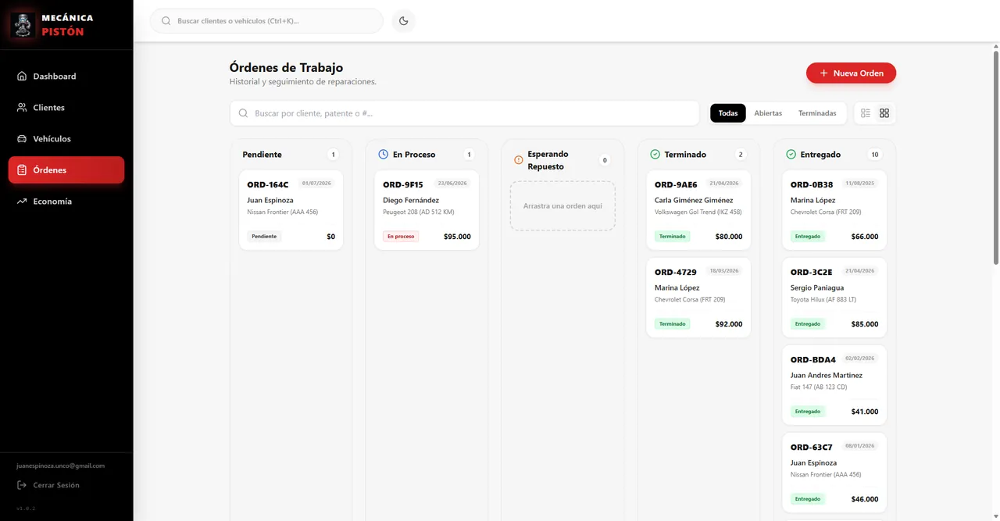
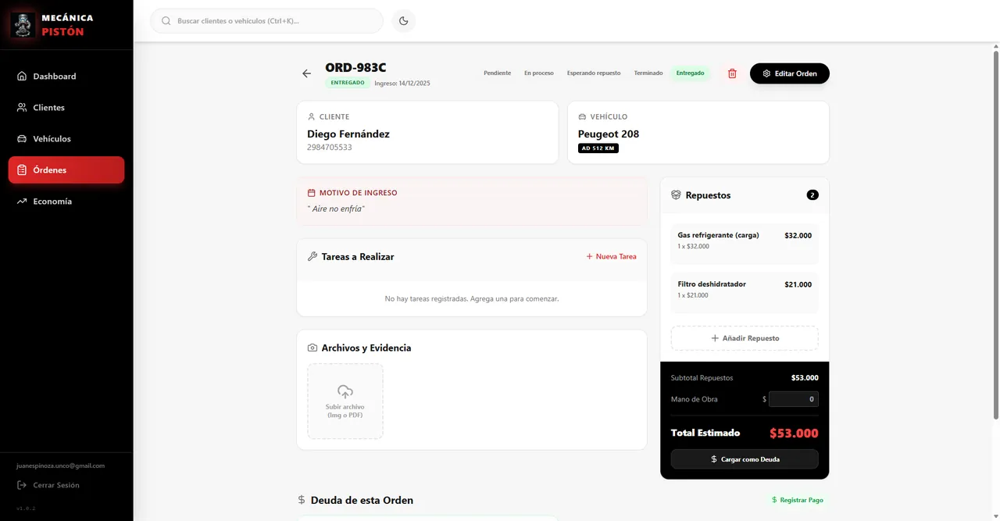
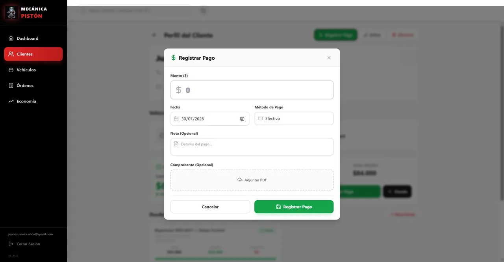
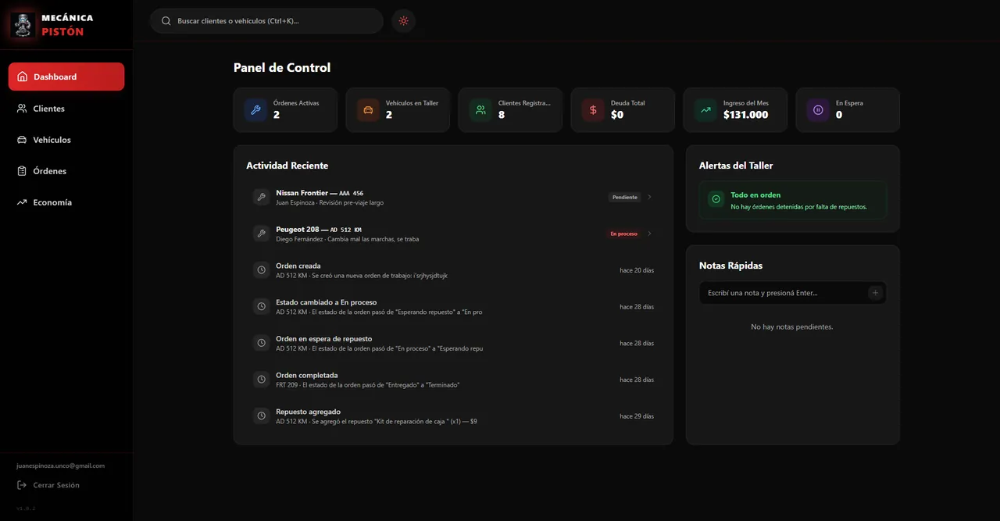
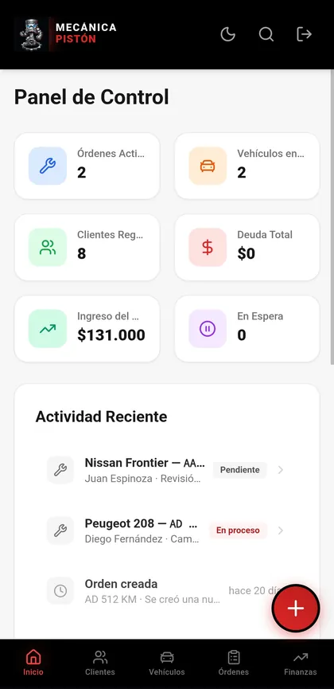
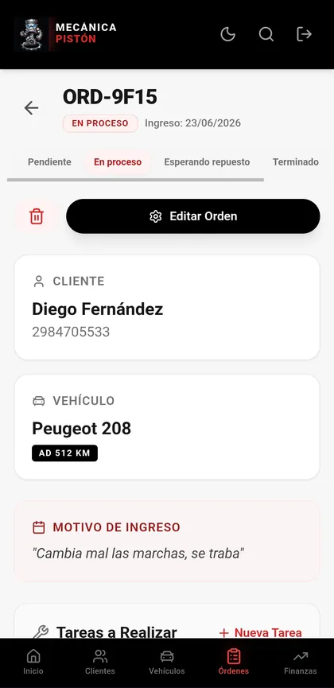
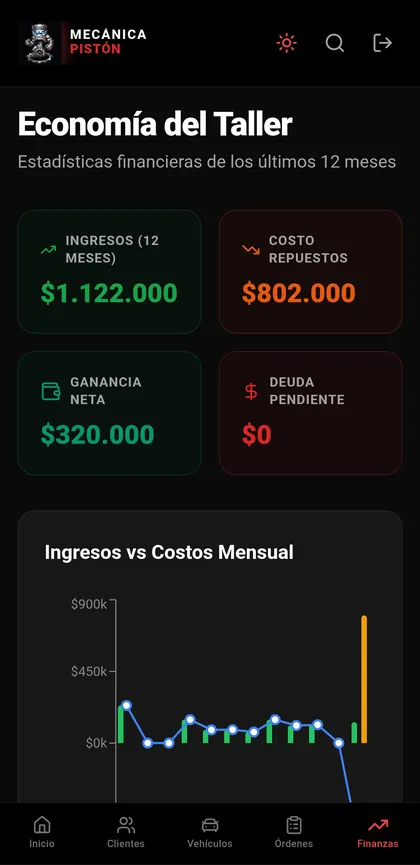
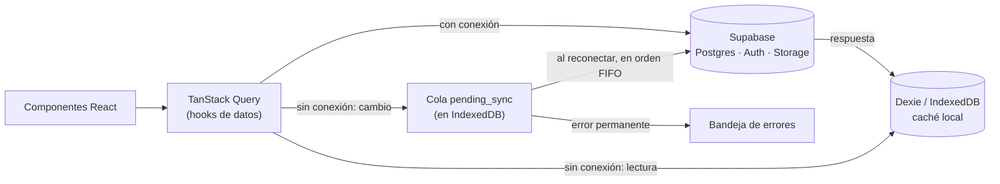

# ⚙️ Mecánica Pistón

**Sistema de gestión para un taller mecánico real**, en producción desde mayo de 2026. Es una PWA *offline-first*: si se corta internet en el taller se puede seguir trabajando, y los cambios se mandan al servidor cuando vuelve la conexión.

Administra clientes, vehículos, órdenes de trabajo, repuestos, deudas, pagos y fotos de cada trabajo, desde la computadora del taller o desde el celular.


---

## Capturas

| Dashboard | Tablero de órdenes |
|---|---|
|  |  |
| **Detalle de una orden** | **Registro de un pago** |
|  |  |
| **Modo oscuro** | **En el celular** |
|  |    |

---

## Funcionalidades

- Clientes y vehículos, con validación de patentes argentinas (`AAA 123` y `AA 123 BB`).
- Órdenes de trabajo con estados, checklist de tareas, repuestos, mano de obra y total estimado. Vista en lista o en tablero.
- Historial de cada vehículo, generado por triggers en la base.
- Deudas (en una cuota o en varias) y pagos con comprobante PDF. El saldo de cada deuda lo calcula Postgres a partir de los pagos.
- Economía: ingresos, costo de repuestos, ganancia y proyección de cuotas de los últimos 12 meses.
- Fotos y PDF por orden, con compresión de imágenes antes de subirlas.
- Búsqueda global (`Ctrl+K`) que ignora acentos, mayúsculas y espacios.
- Instalable como app, con modo claro y oscuro.
- Uso sin conexión con cola de sincronización: ver [Arquitectura offline](#arquitectura-offline).

---

## Stack

| Capa | Tecnologías |
|---|---|
| Frontend | React 19, Vite 8, React Router 7, Tailwind CSS 3, lucide-react, Recharts |
| Datos y estado | TanStack Query 5, Zustand, React Hook Form + Zod 4 |
| Offline | Dexie 4 (IndexedDB), service worker con Workbox (`vite-plugin-pwa`) |
| Backend | Supabase: Postgres con RLS y triggers, Auth, Storage |
| Calidad | ESLint, Vitest + fake-indexeddb, GitHub Actions |
| Deploy | Netlify |

---

## Arquitectura offline



**Lecturas.** Cada hook de datos (`src/hooks/`) usa `offlineQuery` (`src/hooks/offlineHelpers.js`):

- **Con conexión** consulta Supabase, guarda el resultado en IndexedDB y lo devuelve.
- **Sin conexión** lee de IndexedDB.
- **Si la red falla** a mitad de camino, usa lo que haya en caché.

Al guardar, el caché se **reconcilia**: lo que se borró desde otro dispositivo también desaparece localmente. Los registros con cambios sin sincronizar no se tocan.

**Escrituras.** Sin conexión, `offlineMutation` aplica el cambio en IndexedDB (la pantalla se actualiza enseguida) y lo encola en `pending_sync`. Los ids se generan en el cliente, así un registro creado offline conserva su id al sincronizar y otros registros pueden apuntar a él.

**Sincronización** (`src/db/offlineService.js`). Al reconectar o al iniciar sesión, la cola se procesa en orden:

- **Problema momentáneo** (5xx, timeout, sesión vencida): se reintenta con espera exponencial, sin alterar el orden.
- **Rechazo del servidor** (dato duplicado, constraint, permisos): la operación pasa a una **bandeja de errores** visible, donde se puede reintentar o descartar, y la cola sigue.
- **Reintento de algo que ya había llegado** (por ejemplo, se cortó la conexión antes de la respuesta): un `23505` en un insert cuyo id ya existe se toma como sincronizado.
- Un lock evita dos procesamientos en paralelo.

**Archivos.** Los buckets son privados: fotos y comprobantes se muestran con URLs firmadas que vencen. El service worker guarda las imágenes sin el parámetro `token`, así una foto ya vista se sigue mostrando offline aunque su URL haya vencido. Un comprobante de pago elegido sin conexión se guarda en IndexedDB y se sube al reconectar.

**Cerrar sesión** borra IndexedDB y las cachés del service worker. Si hay cambios sin sincronizar, la app avisa antes.

---

## Base de datos

Todo el SQL está en [`supabase/`](supabase):

| Archivo | Para qué |
|---|---|
| `schema.sql` | Crea la base completa desde cero, ya en el estado final. **Borra las tablas existentes.** |
| `migrations/001_rls_autenticado.sql` | Reemplaza las políticas abiertas del schema original por acceso solo autenticado. |
| `migrations/002_storage_y_funciones.sql` | Políticas de Storage; `get_saldo_cliente` deja de saltear RLS. |
| `migrations/003_monto_pagado_calculado.sql` | Triggers que calculan `monto_pagado` y el estado de cada deuda desde los pagos. |
| `migrations/004_mano_de_obra.sql` | Columna `mano_de_obra` en las órdenes. |
| `migrations/005_buckets_privados.sql` | Pasa los buckets a privados (después del deploy del front). |
| `migrations/006_usuarios_autorizados.sql` | Opcional: restringe el acceso a una lista de usuarios. |

**Seguridad.** RLS deja entrar a cualquier usuario con sesión, así que **el registro público tiene que estar deshabilitado**: *Authentication → Sign In / Providers → Allow new users to sign up*. Las cuentas del taller se crean a mano desde *Authentication → Users*. La migración 006 agrega una segunda barrera, por si alguien reactiva el registro.

### Base nueva

1. Crear un proyecto en Supabase y correr `supabase/schema.sql` en el SQL Editor. También crea los buckets `archivos` y `archivos_pagos`, privados.
2. Deshabilitar el registro público y crear los usuarios del taller.
3. (Opcional) Correr la migración 006 con los ids de esos usuarios.

### Base existente (producción)

En este orden:

1. Revisar las políticas activas con `select * from pg_policies where schemaname = 'public';`. Si aparece "Permitir todo a todos temporalmente", correr la **001**.
2. Deshabilitar el registro público.
3. Correr la **002**, la **003** (antes, el `SELECT` del encabezado muestra qué deudas cambian al recalcularse) y la **004**. Son compatibles con la versión anterior del front.
4. Desplegar el front.
5. Cuando los dispositivos del taller hayan cargado la versión nueva (se ve abajo del menú lateral), correr la **005**.
6. (Opcional) Correr la **006**.

---

## Desarrollo local

Requiere Node 22.

```bash
git clone https://github.com/JuanEspinoza8/mecanica-piston.git
cd mecanica-piston
npm install
cp .env.example .env   # completar con la URL y la anon key del proyecto de Supabase
npm run dev
```

| Script | Qué hace |
|---|---|
| `npm run dev` | Servidor de desarrollo |
| `npm run build` | Build de producción (incluye el service worker) |
| `npm run lint` | ESLint |
| `npm test` | Tests con Vitest |

Los tests cubren la capa offline (cola, reintentos, bandeja de errores, reconciliación del caché, borrado en cascada) y los schemas de Zod. Usan IndexedDB en memoria (`fake-indexeddb`) y un cliente de Supabase falso, así que no necesitan backend. GitHub Actions corre lint, tests y build en cada push y pull request.

En Netlify hay que cargar `VITE_SUPABASE_URL` y `VITE_SUPABASE_ANON_KEY` como variables de entorno. La anon key es pública por diseño: lo que protege los datos son las políticas RLS.

### Estructura

```
src/
├── components/        Componentes compartidos (formularios, modales, layout)
│   └── orden/         Secciones del detalle de una orden
├── db/                Dexie (database.js) y cola de sincronización (offlineService.js)
├── hooks/             Hooks de datos por entidad + offlineHelpers.js
├── lib/               Cliente de Supabase, schemas de Zod, URLs firmadas, utilidades
├── pages/             Una página por ruta (carga diferida)
└── store/             Estado global con Zustand (tema, sesión, contadores de la cola)
supabase/              Schema y migraciones
```

---

## Limitaciones conocidas

- **No es tiempo real.** No se usa Supabase Realtime. Un dispositivo ve los cambios de otro cuando vuelve a consultar: al entrar a una pantalla o al recuperar el foco.
- **Conflictos.** Si dos dispositivos editan el mismo dato sin conexión, queda el último que sincroniza. La excepción es el saldo de las deudas, que siempre recalcula el servidor.
- **Fotos y PDF de las órdenes:** subirlos y borrarlos requiere conexión. Sin conexión solo se ven las fotos ya abiertas o precargadas antes, y los PDF no se abren. Los comprobantes de pago sí se pueden adjuntar sin conexión.
- **Un solo nivel de acceso.** Todos los usuarios del taller ven y editan todo. No hay roles ni varios talleres en la misma base.
- **Datos borrados en cascada.** Borrar un cliente borra sus vehículos, órdenes, deudas y pagos. Borrar una orden conserva las deudas y los pagos, sin vínculo a la orden.
- **Saldo estimado sin conexión.** Después de un pago offline, el saldo de la deuda es una estimación local hasta sincronizar.
- **Tests.** Cubren la lógica de datos y validación. No hay tests de componentes ni end-to-end.

---

## Historial y equipo

La rama por defecto, `production`, es la que despliega Netlify. Empezó como un squash de [`develop`](https://github.com/JuanEspinoza8/mecanica-piston/tree/develop), que conserva la historia completa: los PRs #51 a #56 y los commits de Lucas. Las dos historias están conectadas con un merge, así que `git log` en `production` muestra todo.

<table>
  <tr>
    <td align="center">
      <a href="https://github.com/JuanEspinoza8">
        <br />
        <b>Juan Espinoza</b>
      </a>
      <br />
      Lead Developer
    </td>
    <td align="center">
      <a href="https://github.com/Lucas-04git">
        <br />
        <b>Lucas</b>
      </a>
      <br />
      Frontend Developer
    </td>
  </tr>
</table>

Lucas hizo, entre otras cosas, el login con pantalla de carga, el módulo de pagos en cuotas, la línea de tiempo del historial, las notas rápidas, el indicador de conexión y la búsqueda en el celular.

## Licencia

[MIT](LICENSE)
